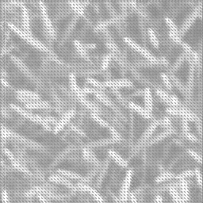

# Effect of Pesticides on Crop Health Monitoring Based on NDVI Using Machine Learning

Code from my undergraduate research project at MIT ADT University, Pune (Jan–Dec 2024), published
at DELCON-2024.

**Paper:** S. Pawar, A. Badure, A. Bade, S. Kolhe, P. Takwane, "Effect of Pesticides on Crop Health
Monitoring Based on NDVI Using Machine Learning," *Proceedings of DELCON-2024*, IEEE.
[IEEE Xplore](https://ieeexplore.ieee.org/document/10866473/)

---

## The problem

NDVI (Normalized Difference Vegetation Index) is a standard measure of crop health, but it needs a
near-infrared (NIR) band. Multispectral cameras and sensors that capture NIR are too expensive for
most small farms. The research question was whether crop health could be monitored from ordinary RGB
images instead.

## What the paper did

- Used the Global Wheat Head Dataset (4,700 public RGB images of wheat fields).
- Approximated the NIR band from the red and green channels, then computed NDVI.
- Trained a VGG19-based model with a custom NDVI layer to predict NDVI directly from RGB images.
- Reviewed agricultural sensors, cameras, drone imaging, and ML methods in farming for the literature
  review.

The paper named the NIR approximation as its main limitation and proposed generating NIR with a
conditional GAN as future work.

## What this repository contains

`SyntheticNIRcGAN.ipynb` is that follow-up: a proof of concept that learns the NIR band from RGB
instead of approximating it with a formula.

| Component | Detail |
|---|---|
| Approach | Image-to-image translation (pix2pix-style conditional GAN), following [Yuan et al., 2020](https://doi.org/10.5194/isprs-annals-V-3-2020-279-2020) |
| Generator | U-Net, 3-channel RGB in → 1-channel NIR out |
| Discriminator | PatchGAN, sees RGB + NIR (4 channels) |
| Loss | Adversarial (MSE) + L1 reconstruction |
| Data | Sentinel-2 multispectral tiles from the SEN12MS dataset (RGB = bands 4/3/2, NIR = band 8) |
| Framework | PyTorch, rasterio |

Sample output (generated NIR band, 256×256):

`generated_nir_16bit_1.tiff` is the same output at 16-bit depth for use in NDVI calculation.

**Scope:** trained on a small sample of 17 tiles to validate the pipeline end to end. Extending it
would mean training on the full SEN12MS set, evaluating on held-out tiles, and feeding the generated
NIR back into the NDVI model from the paper.

## Run

1. Download Sentinel-2 tiles from [SEN12MS](https://mediatum.ub.tum.de/1474000) into a local folder.
2. Open `SyntheticNIRcGAN.ipynb`, set the dataset path in the dataset cell, and run all cells.
   A GPU is recommended for training.
